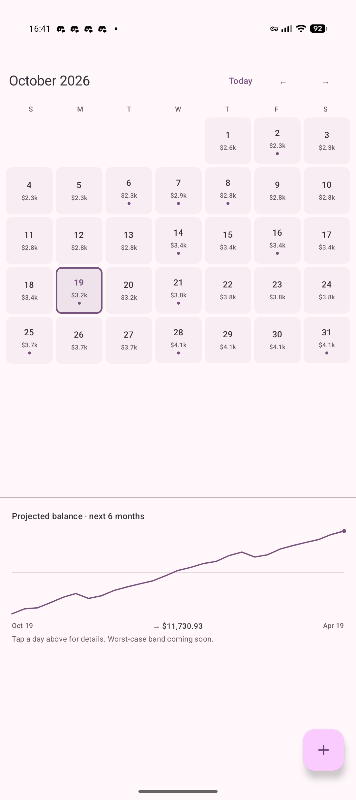
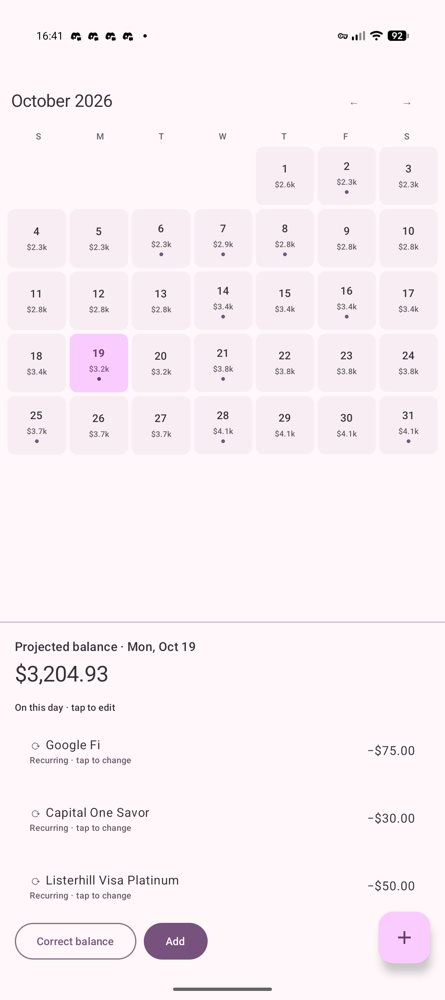
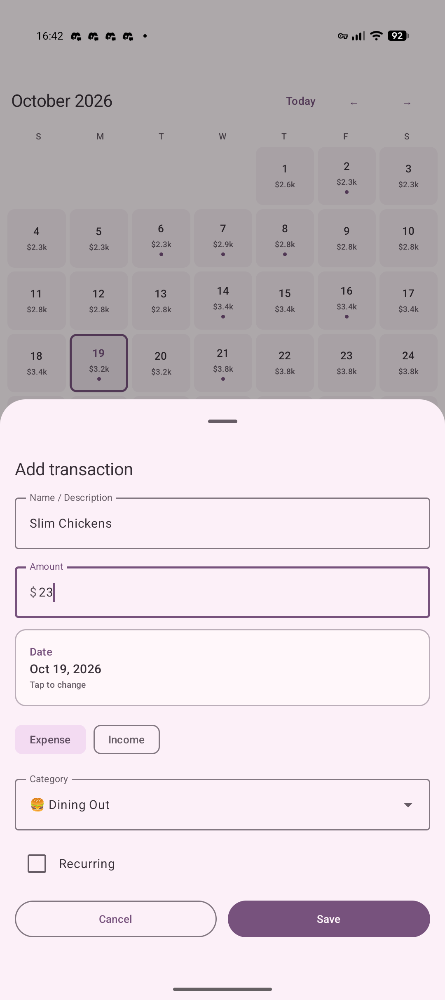
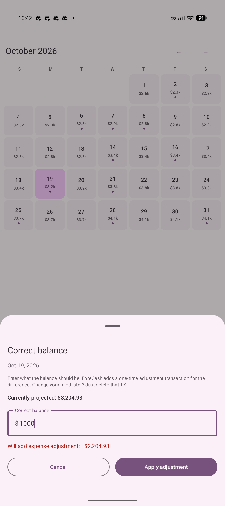

**Note.** The code in this project was generated automatically to match my design, and I tested it from the user side.

# ForeCash

A budgeting app for Android. It shows a cash-flow forecast on each day of the calendar, and a long-term trend chart below it. You can look ahead and see a projection built from what you have already entered. The interface uses Material You.

  
  
  
  

Future recurring rows are not stored. `ProjectionEngine` builds them from the last change to an amount, a frequency, or a day, and it prefers real data when it has it: an anchor, an override, or a transaction that already happened. A recurring transaction can skip a day.

## To do

- [ ] Reverse a skipped day without deleting that day's entry.
- [ ] Manage transactions with multi-select.
- [ ] Support more than one account, and transactions between accounts.
- [ ] Allow a transaction dated before the initial balance.

Open the folder in Android Studio, sync Gradle, and run. JDK 17 or newer.
